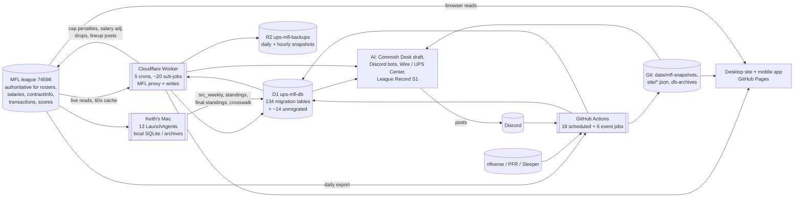

# UPS data infrastructure baseline (2026-11-21)

**What this is:** the first evidence-based map of UPS data: what exists, where it comes from, how it moves, what depends on it, which controls exist, and what to fix first. Owned by the data-infrastructure session; it is a working record, not a ruling. Keith's decisions are recorded separately when made.

**Scope of the pass:** read-only. Code at `main` `bc607887` (2026-11-21). GitHub run history read about 01:00Z 2026-11-22. Local files on Keith's Mac (LaunchAgents, local archives) inspected by name and schedule only. **Not done:** no production D1 query, no MFL call, no R2 listing, no Discord read. One Cloudflare analytics read (`scripts/d1_usage.py`, reads no D1 rows).

**Labels:** **V** verified (code, file or run log read) · **D** derived (computed from verified inputs) · **A** assumed · **U** uncertain/unknown. Evidence appendices hold the file:line detail:
- [`evidence/D1_TABLES_2026-11-21.md`](evidence/D1_TABLES_2026-11-21.md): all 134 D1 tables, keys, writers, readers, status.
- [`evidence/JOBS_2026-11-21.md`](evidence/JOBS_2026-11-21.md): 87 workflows, 5 worker crons, 13 Mac jobs, run history.
- [`evidence/ASSETS_AND_CONSUMERS_2026-11-21.md`](evidence/ASSETS_AND_CONSUMERS_2026-11-21.md): committed data files, R2, mobile, AI and rulebook consumers.
- [`evidence/CONTROLS_2026-11-21.md`](evidence/CONTROLS_2026-11-21.md): every integrity, monitoring and recovery control found.

Privacy and credential findings are not described here. They are already tracked in draft PR #1489 and in Keith's private containment plan from PR #1455.

---

## Plain English

- **Most league data comes straight from MFL, and the live screens read it fresh.** That part is sound.
- **The weak spots are around it:** several important tables are refreshed only when Keith's Mac is awake, most jobs fail silently, and freshness ("as of") is shown for very few sources.
- **The one daily check built to catch roster and contract destruction is broken.** Since 11-19 it has been red every day, and every alert was false. It fails 34 of its last 60 runs, so a real incident would look like routine noise. The fix is small.
- **A one-time drop job approved for 2026-09-07 is still armed on the Mac.** It runs every morning and aborts.
- **Owners' player profiles show a "contract history" from tables no current code can rebuild or explain.**
- **D1 is within Free-plan limits but not by much:** on 11-21 it used 65% of the daily read allowance and 28% of writes.

---

## 1. Current-state map

**Authority (V, `docs/DATA_AUTHORITY_MAP.md` 2026-05-29, still accurate in principle):** MFL owns every fact it exposes. UPS owns league rules (canon), contract derivation math, audit trails and the standings ranking layer. External sources own advanced stats and ADP.

**Where the map differs from what the docs say (V):**
- `docs/SCHEDULED_PIPELINE_AUDIT.md` and `docs/BACKUP_STRATEGY.md` are out of date. Examples: the 09:05 UTC daily window actually runs 16:40 to 18:24 UTC (GitHub schedule lag of 7 to 10 hours); the MYM dashboard job is disabled, not running; the local SQLite backup is not installed; the `log-*` jobs commit JSON to the repo, not D1.
- `docs/LINEAGE.md` (2026-02-16) describes a SQLite-only pipeline that is no longer the main path.
- The UPS 2.0 source-of-truth matrix (`docs/ups_v2/V2_GOVERNED/data/source_of_truth_matrix.csv`) names `raw.*`, `core.*`, `ref.*` and `ops.*` layers from the abandoned SQLite/BigQuery design. None exists in D1 (see §3, G1).

---

## 2. Data asset inventory (first pass)

One row per asset family. "Checks" means checks that exist and run today. Status values: verified, incomplete, stale, duplicated, conflicting, undocumented, unknown.

### 2a. MFL-sourced current state

| Asset | Purpose → consumers | Source → pipeline → store | Grain / keys | Time semantics | Checks / failure behavior | Freshness / history | Confidence · status |
|---|---|---|---|---|---|---|---|
| Live MFL exports via worker (`/api/mfl-export`, `/roster-workbench`) | Rosters, salaries, contracts, cap for desktop, mobile, AI desk | MFL → worker proxy (60 s cache) → browser | player × franchise, current | "Now", but `contractYear` = years remaining; `weeklyResults` without W = last completed week | No shape or row-count check on responses; many reads default to `[]` on error (I, controls appendix §D) | Live; no history | V · verified source; **gap:** no "as of" stamp on most routes |
| MFL daily snapshots `data/mfl-snapshots/YYYY-MM-DD/` (10 exports) | Backup, anomaly checks, Wire, valuation, League Record | `mfl-daily-snapshot.yml` → git | export file per UTC date | Folder date = UTC run date; pulled 16:40-18:24Z, not 09:05 | Red only on HTTP error. Injuries were stored empty for ~111 days on green runs before 08-22 | 213 days from 2026-04-21; 2 days missing | V · incomplete (injuries before 08-15) |
| R2 `snapshots/<date>/` + `snapshots/hourly/` | Pre-drop contract for drop pricing and waiver card | Worker cron → R2 | export per date; rosters per hour (10-day retention) | UTC date of first successful tick after 09Z | Stores non-JSON MFL error bodies as data; writes the "done" marker even when parts fail, so the hourly retry never re-runs; console-only logging (V `index.js:494-559, 8655-8676`) | Daily since Phase 2; only `rosters.json` is ever read | V · **defect:** partial or error snapshot looks complete |
| D1 `ups_transactions` ledger | Activity, drop/add detection | Worker */5 cron → D1 | MFL transaction | MFL timestamp (pre-2024 trades often processing time) | Ungated; a comment records it once threw every tick unnoticed | Current season | V · unknown completeness |
| D1 `src_franchises`, `src_league_season_meta` | Divisions, names, limits | `nightly-config-sync.yml` → D1 | franchise × season | Daily | Red on failure only | Green last 6 runs | V · verified |
| D1 `src_weekly`, `src_adddrop`, `src_schedule`, `src_standings`, `src_franchise_weekly_score` | Standings, playoff bracket, player bundle, leaderboards, starter rates, AI desk | **Mac LaunchAgent** `live-season-sync` → delete-and-reinsert the season | player × week; franchise × week | Tuesday + Thu/Fri | None beyond the script; no alert if the Mac is asleep | Current season; history from Mac loads | V · **single point of failure** |
| D1 contract submissions (`ups_extension/restructure/mym/tag_submissions`) + masters | Front Office, drop scan, restructure cap, player bundle | Worker routes → D1 | submission (autoincrement id) | Submission time | Duplicate guard is select-then-insert; two simultaneous requests can both pass (V `index.js:57373`) | 2026 complete (A); earlier via data migrations | V · **duplicate risk** |
| D1 `ups_drop_events` + `/api/salary-adjustments/ledger` | Cap penalties, next-season adjustments, AI `cap.adjustments` | Worker drop tracker (*/5, posts to MFL) → D1; static `site/reports/salary_adjustments/*` used only for 2025-era details | drop event | Drop time; priced from R2 pre-drop snapshot | Pricing trigger audits rows (migration 0166); held/unpriced drops log to console only | 2026 in D1; static files 2012-2025, last 2026-10-06 | V · inherits the R2 snapshot defect |
| Static `site/reports/salary_adjustments/salary_adjustments_<year>.json` (2026 file built 2026-10-06) | Loaded by mobile (`site/m/app.js:1159`, not used in cap totals); read by `roster_workbench.js:2856` and `trade_workbench.js:1548`; desktop FO v2 replaced it with the live MFL feed | Built locally, committed by hand | adjustment row | Build time | None | 2012, 2017-2026 | V readers · **a candidate projection, not a ledger.** 10 of 31 amounts differ from what MFL posted. The backlog session traced all 10 to canon §D1's sub-$5K TCV rule (fixed $1K), which the file does not apply; with the rule applied, all 31 reconcile (#1502). On mobile the read is dead: `computeCapFor` uses only the MFL feed. How the two classic workbenches use the rows is not checked |
| MFL `salaryAdjustments` (posted cut penalties) | Cap totals everywhere | Worker drop tracker posts to MFL | adjustment row | Post time | Category depends on exact description text (#1503 BL-M06) | 2026: 41 cut-penalty rows, 31 carry an add/drop id with no player id (#1502, BL-I30) | Reported by the backlog session · **incomplete player attribution** |
| D1 `salary_change_log` | Audit of salary writes | Worker, created at runtime (no migration) | write event | Write time | Only about 3 of ~11 salary-write paths log here (controls appendix §E) | 2026 | V · **incomplete audit** |
| D1 `player_contracts`, `player_contract_stints` | "Contract History" in the player profile (`site/shared/player_profile_master.js:540`) | **No writer and no migration in the repo.** A 2026-05-13 spec says "~9,700 rows, already built" (`docs/specs/contract_stints_integration.md`) | contract; ownership stint | Origin/termination dates | None | Unknown | V code · **undocumented, unreproducible**; contents U |
| D1 trades (`ups_2way/3way_trades`, `ups_trade_executions`) | Trade inbox, commish queue | Worker trade modules | offer; execution | Event time | Execution-integrity guards (V, controls §D) | 2026 | V · verified for current flow |
| Bot-refreshed files `site/trades/extension_previews_2026.json`, `site/rookies/franchise_assets_2026.json`, `contract_activity_2026.json` | Mobile extension pricing, rookie hub, activity | Hourly/nightly workflows → git | player; franchise | Commit time | Commit only on diff; Pages may not redeploy after bot commits (I) | Current | V · freshness on github.io U |
| Hand-refreshed files `player_acquisition_lookup_2026.json` (03-10), `tag_tracking.json` (03-09), `tag_submissions.json` (02-16) | Mobile, desktop FO, roster/trade workbenches, `/admin/health-summary` | No producer in repo for the lookup | player | Last commit | None | Newest acquisition 2025-12-28 | V · **stale**; mobile and v2 overlay MFL transactions, others U |

### 2b. Stats, projections and identity

| Asset | Purpose → consumers | Source → pipeline → store | Grain / keys | Time | Checks / failure | Freshness / history | Confidence · status |
|---|---|---|---|---|---|---|---|
| `nfl_player_weekly` (+`_ext`), snaps, redzone, EPA, NGS, etc. | Player box, SOS, leaderboards, AI stats | `nflverse-stats-refresh.yml` → `D1Writer` changed-only | player (gsis) × season × week | Runs 5-9 h after cron | Fails on source error; stamps `etl_runs` | Multi-season | V · verified pipeline; `nfl_player_weekly` at D1's 100-column cap |
| `nfl_player_depth_weekly`, `nfl_player_injuries_weekly` | None (research only) | Same refresh | player × week | — | — | Written every run | V · **write-only: D1 writes with no reader** |
| `nfl_leaderboard_precompute` (+meta) | Stats leaderboards | Worker build route after refresh | season × position | Build time | Self-verifies through the read route | Current season | V · verified |
| `ups_player_projections` | Wire, season sim (not the worker) | `ingest-projections.yml` 6×/week | player × week | Capture week only; Wednesday run re-stamps last week (known bug) | Red on failure (failed 11-20) | Captured weeks only | V · known defect |
| `player_id_map` | MFL ↔ nflverse ids | nflverse workflow | MFL id | Build time | `change_ignore_cols` stamp | Current | V · verified |
| `player_id_crosswalk`, `metric_stickiness` | Player bundle advanced stats, many worker reads | **Mac only** `scripts/load_local_to_d1.py` (full re-upsert) | MFL id | Last Mac load | None | Unknown last load | V · **stale risk** |
| `etl_runs` | `/api/data-freshness`, Stats freshness chips, AI `data.freshness()` | nflverse refresh + `discord_reconcile.py` only | source | Last success | — | — | V · **covers 2 of ~25 data jobs** |

### 2c. History, rules, Discord, AI inputs

| Asset | Purpose → consumers | Source → pipeline → store | Grain / keys | Time | Checks / failure | Freshness / history | Confidence · status |
|---|---|---|---|---|---|---|---|
| `src_final_standings`, `src_baselines`, `src_pointssummary`, `src_weekly_franchise_summary` | Historical finishes, eras, Hall of Champions, owner career stats (CI job), AI `history.*` | **Mac only** `load_local_to_d1.py` | franchise × season | Season | `/api/eras` mislabels finish 12 as Toilet Bowl winner (it is 7) (V, AI readiness review) | 2010-2025; 2026 finals need a manual Mac load | V · stale risk; 2010 disputed (#1386) |
| Local archive `data/db-archives/mfl_database_2026-06-05.db.gz` | League Record S1, auction/draft intel builders | Manual upload | 101 tables | Frozen 2026-06-05 | None | Single copy in git | V · history source for S1; coverage gaps in #1486 |
| Local Mac SQLite `mfl_database.db` | ~20 local builders | Mac ETL | — | — | Backup script never installed; documented paths missing | Only 2025 iCloud copies found (I) | V · **no working backup** |
| Canon → `site/m/data/rules.json` | Mobile rules, AI desk rule tools | `rulebook-build.yml` (CI) | rule anchor | `canon_sha` | Canon-drift check; topics-only edits skip the build (path filter) | Every canon push | V · verified, small gap |
| `ups_discord_messages` | Wire, UPS Center | `discord-chat-ingest.yml` weekly (table has no migration) | message | Message time | "Nothing new" on 3 of last 5 runs, cause U | Weekly | V · undocumented schema |
| Discord archive tables (`discord_message_events`, revisions, sync health) | None | `discord-reconcile` (disabled since 09-16) | — | — | — | Stopped | V · write-only, dormant |
| Valuation snapshot `data/valuation/trade_valuation_snapshot.json` | Trade grader bot, AI optional tool | `valuation-snapshot-rebuild.yml` every 3 h | player | Build time; 8/14-day freshness rule | **Opens a GitHub issue on failure** (the only workflow that does) | Current | V · verified |
| Wire / UPS Center packs (`site/wire/**`) | Weekly publication, Deep Cuts | Mac + CI builders | week | Build time | Facts carry `sources`/`asof`; packs with no sources are rejected | Through Week 10 | V · best-labeled AI input |
| Historical evidence registers (local, private) | UPS 2.0 history, AI | Local scripts | event | Effective dates recorded | — | 2010-2025 | Per AI session memory; not re-checked here |

**Counts behind the tables (V):** 134 D1 tables in migrations: 104 active, 12 write-only, 8 read without a writer in the repo, 8 orphaned, 1 dropped. About 14 more tables are used in production with no migration (5 created at runtime, others created outside the repo). 87 workflows: 19 scheduled (2 disabled), 50 manual one-offs.

---

## 3. Current state vs UPS 2.0 (v8 draft, PR #1454)

### Confirmed gaps

| # | Gap | Evidence | Why it matters for 2.0 |
|---|---|---|---|
| G1 | v8's gate step 3 says to confirm data sources "against `source_of_truth_matrix.csv`", but that matrix names layers that don't exist | Matrix rows such as `raw.mfl_salaries`, `core.contract_event`; ADR-0002 says D1 is the only store | The gate can't be satisfied as written. Needs a current-platform source registry (this inventory is the seed). |
| G2 | No contract event ledger; the pieces that exist don't add up to one | Submission tables lack unique keys; `salary_change_log` covers ~3 of ~11 salary writes; profile contract history comes from unwritten tables | Release 5 ("how each contract came to be") has no trustworthy base yet. |
| G3 | No separate test data environment | `worker/wrangler.preview.toml` binds the production D1 id `8cfe1ddd…` (V) | Any preview that writes, or a heavy query, hits production and the shared Free-plan budget. |
| G4 | "As of" times exist for few sources | `etl_runs` covers nflverse and Discord only; `/api/standings`, `/api/player-status`, `/api/mfl-export` return no source stamp (controls appendix) | Release 2 requires "as of" times on every screen. |
| G5 | Release 1's recorded snapshot lacks names/positions and is raw MFL, not the FO repaired view | v8 §Release 1 | Already listed in v8 as open rulings. |
| G6 | Mac-only writers feed production tables | §2 (`src_weekly`, standings, final standings, crosswalk) | A 2.0 surface that is "live" still depends on the Mac being awake and on a checkout that is 35 commits behind `main` with 7 uncommitted files (V). |
| G7 | No D1 backup or restore procedure | Controls appendix §G: hand-taken Time Travel bookmarks only | A migration or backfill mistake has no rehearsed recovery. |
| G8 | Historical coverage is not machine-readable for consumers | Gaps live in issues #1386, #1486, #1497, #1307 | AI and Stats can't consult "is this covered?" at query time except through the planned `coverage.check` file. |

### Open questions (not gaps until answered)

- Contract authority (MFL vs UPS record): open in v8; this inventory adds that the profile already shows a UPS-built history whose authority was never decided.
- What `player_contracts` / `player_contract_stints` hold in production and who built them (needs a production read; not approved).
- Whether historical League Record data will live in D1 at all, given 65% daily read use on 11-21.
- Whether BigQuery is retired (v8 open item).

---

## 4. Highest-risk issues (ranked by owner impact)

| # | Issue | What an owner or the league would notice | Evidence | Class |
|---|---|---|---|---|
| 1 | **The daily roster/contract anomaly check (J3) is red on false positives.** `BBID_WAIVER` is missing from `LEGIT_DEPARTURE_TYPES`, and its transaction field (added, then bid, then dropped, separated by pipes) puts the drop in the third segment, where the checker never looks. | Nothing, until a real silent roster or contract destruction (the 08-02 / 08-06 class) is lost in daily noise. | `check_roster_anomalies.py:314`; 11-19, 11-20 and 11-21 runs: 17 flags, each matched to a BBID drop in the same snapshot (sampled 4 of 17, all explained) | Fix |
| 2 | **Failures are silent.** Only one workflow opens an issue; worker cron failures go to the console; the R2 snapshot marks itself complete on partial failure. | Stale numbers or unpriced drops with no warning to anyone. | Controls appendix §A, §D; `index.js:494-559` | Fix |
| 3 | **Production depends on the Mac.** Weekly scores, standings, final standings, the crosswalk and the only external worker-liveness watchdog run there, from an out-of-date checkout. | Standings or scores stop updating when the Mac is off; jobs run code older than `main`. | Jobs appendix §C; checkout at `55ba66be`, 35 commits behind | Enhancement (operations) |
| 4 | **A one-time production drop job is still armed.** `com.keith.mfl.deadline-drop` runs daily at 06:00 and aborts; there is no "done" file; its Discord alert fails. | Very unlikely unintended drops if its old conditions recur; daily failed alerts. | LaunchAgent and `~/.ups_jobs/deadline_drop_2026.py` read by name/logic (V) | Decision (Keith) |
| 5 | **Player-profile contract history comes from tables with no writer, migration or recorded provenance.** | An owner may see a contract history nobody can reproduce or correct. | `index.js:15483-15497`; `player_profile_master.js:540`; #1491 says its reconstruction's production writes are unaudited | Data discrepancy (needs audit) |
| 6 | **Phone and desktop can show different cap room.** Mobile cap math differs from `cap_math.js` in four ways (rounding to $1K, expired-year rule, salary source, blank = $0). | "Cap room" differs between phone and desktop for the same team. | Assets appendix §3 (sub-agent, spot-checked) | Fix (verify first) |
| 7 | **Freshness is invisible for most data, and GitHub schedules run 7-10 hours late.** | A screen can show yesterday's data with no label. | §2; run timestamps | Enhancement |
| 8 | **Schema drift:** ~14 tables without migrations, 10 tables defined twice (migration + runtime), an `ALTER TABLE` attempted on every `/admin/contract-submissions` request. | Hard-to-diagnose breakage after a migration or a new environment. | D1 appendix "schema drift" | Fix |
| 9 | **Nothing runs the safe suite on `main` after merge, and the one bot that does reports a result nobody can trust.** The bot-cutover issue #1399 says `bc607887` has 13 failures. A clean local run at `52338bf9` (`bc607887` plus docs only) passed 275 with 0 failures. The bot most likely ran in the stale, dirty Mac checkout (I). | Trade-bot valuation delivery is blocked by a false red; real regressions on `main` would also go unseen. | #1399 latest auto-comment; local `node scripts/safe_tests/run.mjs` 2026-11-22 | Fix |
| 10 | **Backups:** the local SQLite backup isn't installed; D1 has no scheduled export; 6 of 7 R2 daily exports have no reader or restore test. | A lost history table could not be restored with confidence. | Controls appendix §G | Enhancement |

Lower but real: write-only nflverse tables cost D1 writes with no reader; `sleeper_player_cache` deletes and reinserts daily; `delete-custom-waiver-order` "fails" every Monday by design (exit 78), which trains everyone to ignore red runs; `refresh-acquisition-hub` is green hourly but does nothing; the worker still dispatches the disabled MYM job.

---

## 5. Prioritized control and maintenance plan

Each control lists: failure caught · how detected · how often · what counts as an alert · who responds. Nothing here writes to production; items marked **(go)** need Keith's approval because they change production config, D1 schema or deploy the worker.

### P0: make red mean red (days, small)

1. **Fix J3's BBID_WAIVER gap** and add a regression test from the 11-19 snapshot. · Catches silent roster drops and contract flattening · diff of the last two snapshots vs transactions · daily · any unexplained drop or contract regression · data session triages, Keith decides. Draft PR, offline test only.
2. **Make scheduled "skip" jobs exit green or be removed:** `delete-custom-waiver-order` (exit 78), `refresh-acquisition-hub` (no-op), worker dispatch of the disabled MYM job. · Catches alert fatigue · run conclusions · per run · n/a · data session.
3. **One alert path for every scheduled job** (reuse the valuation workflow's open-or-comment-an-issue step, label `data-alert`). · Catches silent failure · job failure hook · per run · any failed scheduled run, deduplicated per job · data session reads daily; Keith gets one issue, not many.
4. **Retire the armed one-time drop job (go).**
5. **Run Mac jobs from a clean, current checkout** (a dedicated worktree fast-forwarded before each run, refusing to run if dirty or behind) **(go: changes Mac job config).**

### P1: freshness, shape and reconciliation (weeks)

6. **Freshness registry:** every data job stamps `etl_runs` (source, last success, rows, code SHA, status), with a per-asset freshness target in a small YAML file. `/api/data-freshness` reports stale vs target. · Catches stale data · compare stamp to target · hourly · past target · data session; UI shows "as of". Writes ~25 rows per day; read cost one indexed table.
7. **MFL response contract checks** in the snapshot workflow and the R2 snapshot: valid JSON, no MFL error envelope, required keys, row count within ±20% of the previous day; write the R2 "done" marker only when every part passed **(go for the worker change).** · Catches the 111-day empty injuries class and error envelopes stored as data.
8. **Offline schema check in the safe suite:** every table named in `worker/src` and `pipelines` must exist in a migration, or be on an explicit runtime-created allowlist. · Catches schema drift before merge · CI on every PR · test failure · PR author.
9. **Nightly cap reconciliation from the committed snapshot** (no production read): per franchise, FO-style cap used vs MFL roster salaries plus adjustments; and contract-year countdown across seasons. · Catches July-style contract-year rollbacks that J3/J4 both pass · daily · any franchise off by ≥ $1K or any countdown break · data session; contract changes follow `CHANGE_PLAYBOOK.md` §0.
10. **Salary-write audit coverage:** every MFL salary/salaryAdjustment write path logs to `salary_change_log` (migration-defined) **(go).** · Catches unexplained salary changes · weekly reconcile log vs snapshot diffs.
11. **Safe suite on `main`** after each merge and nightly. · Catches regressions merged on a red head.

### P2: lineage, recovery, completeness (month)

12. **Machine-readable asset registry** (`docs/data_governance/assets.yaml`, generated from these tables) with authority, owner, freshness target, coverage, privacy class and consumers; a CI check that every new D1 table or site data file has an entry.
13. **Coverage file consumed at runtime** by Stats and the AI desk (the planned `coverage.check`), generated from #1386/#1486/#1497: "unknown, not zero" enforced in code.
14. **D1 backup and restore drill:** scheduled export to R2 and a restore into a temporary database, measured first (an export reads every row, so frequency must fit the Free plan) **(go).**
15. **Discord-post vs ledger reconciliation** for drops, extensions and restructures.
16. **D1 budget alert:** run `scripts/d1_usage.py` daily in CI; alert at 70% of either Free limit.

### Gate before any new consumer (AI tool, mobile screen, report) relies on an asset

The consumer's PR must show, for each asset it reads: an inventory entry with authority and owner; a freshness stamp and target; machine-readable known gaps; at least one running check that alerts; defined failure behavior (fail closed, unknown is never zero); measured D1 `rows_read`; privacy class; and the limitation text owners will see. Missing any item means the feature labels the data as unverified or does not ship.

### Migration risks for UPS 2.0 and the controls they need

- **Shared production D1 in previews** → separate test database before any write release (G3).
- **Read budget:** 65% used on 11-21 → measure every new 2.0 query; a 2.0 surface plus the current site running in parallel could double reads.
- **Backfills:** each one is a production write → dry run on a local replica, row count and write budget first, preserved originals, no rewrite of finished seasons.
- **Contract authority switch** → v8 already requires loading and reconciling every active contract first; add the P1 cap reconciliation as the evidence.
- **Mac dependence** → port or pin Mac writers before 2.0 calls anything "live".

---

## 6. Decisions and access needed from Keith (asked one at a time)

1. **Asked now:** retire the armed 2026-09-07 one-time drop job on the Mac (see the reply to Keith).
2. Later: where data alerts go (a labeled GitHub issue per failing job, recommended, vs a Discord commish channel).
3. Later: Mac jobs: pin to a clean auto-updated worktree (recommended) vs move each writer to GitHub Actions.
4. Later: a measured, read-only production audit of `player_contracts` / `player_contract_stints` (row counts and dates only).
5. Later: D1 backup approach and frequency after measuring export cost.

---

## 7. Coordination note for the master session

- **This session owns** the data inventory, lineage, integrity controls and operational governance, recorded under `docs/data_governance/`, with a change-and-dependency log in [`CHANGE_AND_DEPENDENCY_LOG.md`](CHANGE_AND_DEPENDENCY_LOG.md).
- **AI desk (#1478) dependencies:** `data.freshness()` reads `etl_runs`, which covers 2 of ~25 jobs, so most tools can't state freshness. `history.*` reads Mac-loaded tables, and `/api/eras` mislabels the Toilet Bowl finish. `cap.adjustments` reads live D1 drop rows (static report only for 2025-era detail), so it is current. `cap.penalty_quote` prices from the R2 pre-drop snapshot, which can be partial without notice (§4 #2).
- **Mobile beta (#1475/#1497) dependencies:** mobile cap math differs from the worker (§4 #6); mobile extension pricing reads the github.io snapshot, whose redeploy after bot commits is unverified; the player profile's contract history comes from unwritten tables (§4 #5).
- **League Record (#1484/#1486):** history inputs are the 2026-06-05 archive and snapshots; no D1 writer exists for it; any D1 design should use the consumer gate in §5.
- **Front Office:** shares the cap-math and contract-history dependencies above.
- **Schema, pipeline or data-model changes** proposed here are not settled until the affected session acknowledges them and Keith approves.
